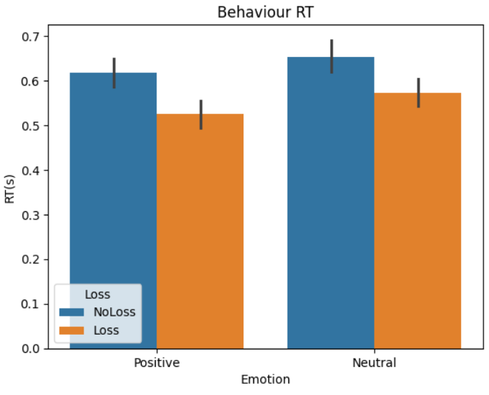
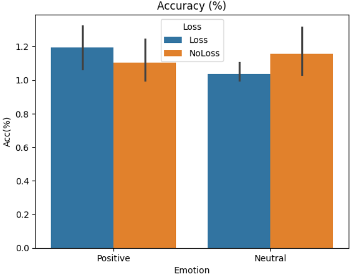
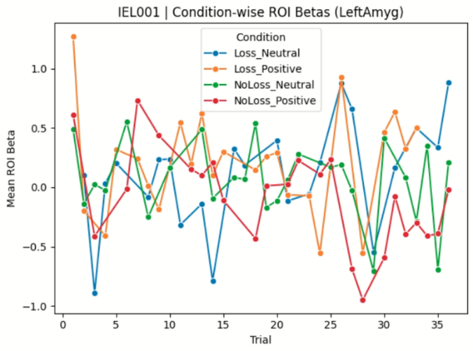
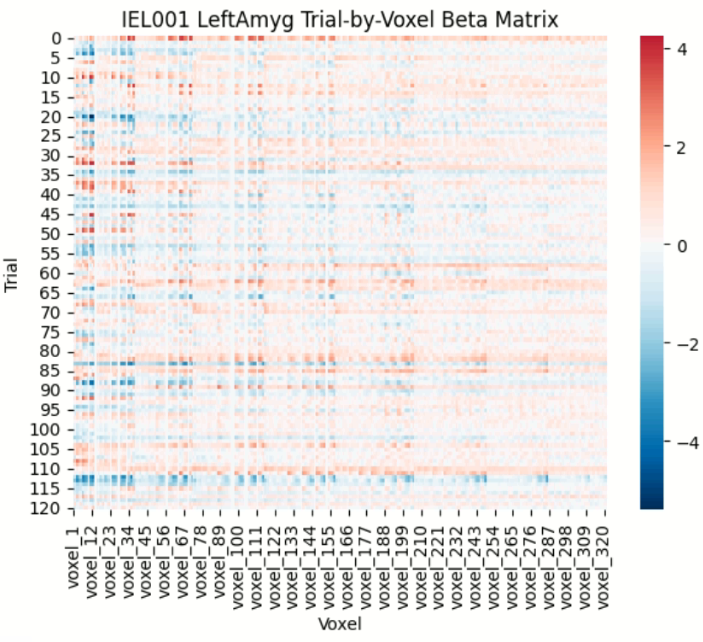
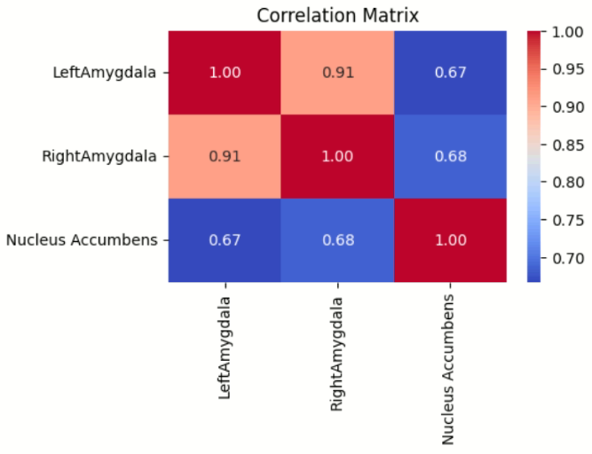
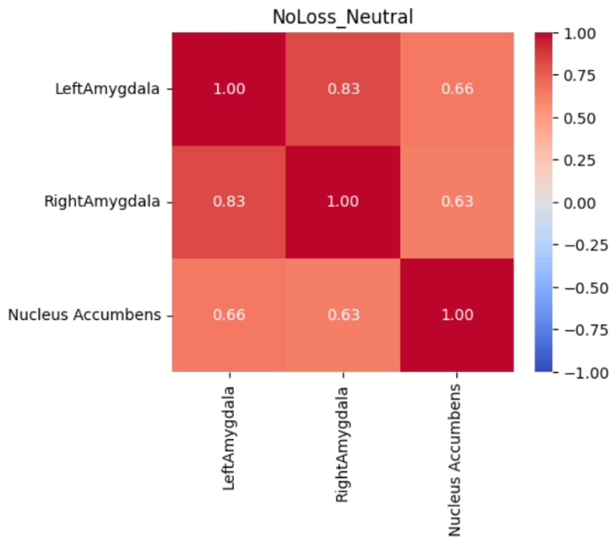
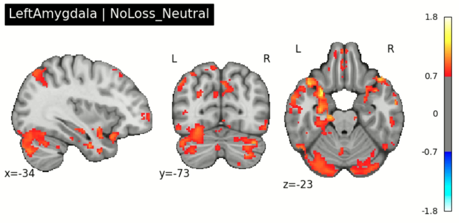
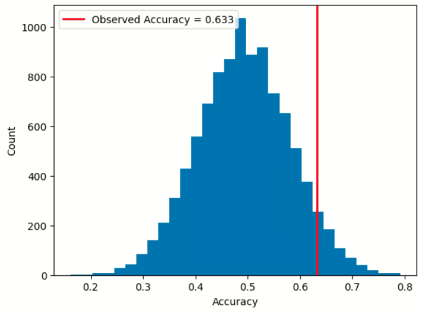
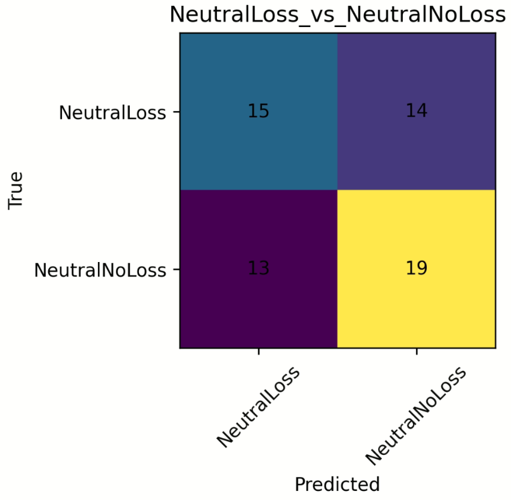

# fMRI Beta-Series Analysis, Functional Connectivity & MVPA Pipeline

**Tools:** AFNI · Python · pandas · NumPy · SciPy · scikit-learn · Nilearn · Matplotlib · Seaborn

## Overview

This repository contains the analysis pipeline developed for an ongoing fMRI study conducted at the Indian Institute of Science (IISc), Bengaluru, involving 37 healthy participants. The data are preprocessed and organized in a BIDS-compatible structure to support reproducible neuroimaging analyses.

As the study is currently unpublished, the full dataset and group-level results cannot be publicly shared. To promote transparency and reproducibility, this repository focuses on the analytical framework and implementation. All figures included here are generated from a single representative participant and demonstrate pipeline outputs rather than study findings.

The pipeline integrates traditional neuroimaging methods with machine-learning approaches:

- Task-event extraction from `.mat` files
- Single-trial voxel-wise beta estimation using AFNI LSS
- ROI-based voxel-wise beta extraction
- Quality control and exploratory visualization
- Beta-series functional connectivity
  - ROI-to-ROI connectivity
  - Seed-to-voxel connectivity
- Multivariate pattern analysis (MVPA)
  - Linear SVM decoding
  - Nested cross-validation
  - Permutation-based significance testing

## 1. Task Events Time-Series Extraction & Dataset Construction

### Key features

- Automated loading of participant-specific MATLAB log files
- Run-level data extraction and aggregation
- Conversion of numerical task codes into interpretable condition labels:
  - Emotion: Positive / Neutral
  - Loss: Loss / No Loss
- Extraction of behavioral measures:
  - Reaction time (RT)
  - Accuracy
  - Cue onset
  - Task onset
  - Inter-stimulus interval (ISI)
  - Inter-trial interval (ITI)
- Removal of incorrect trials
- Condition-specific RT outlier detection and filtering
- Chronological trial ordering across runs
- Generation of standardized participant-level master files

### Outputs

- A trial-wise behavioral dataset containing experimental conditions, behavioral performance, timing information, and metadata required for downstream fMRI modeling and machine-learning analyses.
- A master dataset linking behavioral measures, single-trial beta estimates, functional connectivity analyses, and MVPA decoding.

### Representative outputs

## 2. AFNI LSS Deconvolution Pipeline

Implements **Least Squares–Separate (LSS)** single-trial modeling using AFNI.

### Key features

- Condition-wise GLM estimation via `3dDeconvolve`
- Motion and censor regressors
- Trial-specific beta estimation via `3dLSS`
- Extraction of trial-wise beta sub-bricks
- Output organized by condition and subject

### Output

Whole-brain, single-trial voxel-wise beta estimates saved as NIfTI files for each condition.

## 3. Beta Extraction Pipeline (ROI Level)

Extracts voxel-wise beta estimates from predefined ROIs for each trial.

### Key features

- ROI resampling to subject-specific functional space
- Trial-wise beta extraction using Nilearn masking
- Quality-control checks for missing or invalid beta files
- Condition labeling for the Emotion × Loss interaction
- Generation of:
  - Metadata containing subject and trial details
  - ROI voxel-beta matrices, with voxel beta values stored in separate columns
  - Exploratory plots of beta distributions across trials, per ROI and condition, and trial-by-voxel beta matrices

### Output

A metadata file containing experimental-condition details, beta-file paths, and voxel-wise beta values for each trial.

### Representative outputs

## 4. Beta-Series Functional Connectivity Pipeline

Computes trial-wise neural similarity across ROIs and whole-brain voxels.

### Key features

- ROI-to-ROI correlation matrices
- Condition-specific connectivity analysis
- Seed-based whole-brain connectivity mapping
- Fisher Z-transform for correlation normalization

### Outputs

- ROI mean voxel-beta scores per trial
- ROI × ROI correlation matrices
- Seed-to-voxel connectivity maps (Z-scored)
- Condition-wise functional-connectivity visualizations
- One-sample t-test against zero
- Group-level connectivity map

### Representative outputs

## 5. Multivariate Pattern Analysis (MVPA)

Decodes cognitive states from ROI beta patterns using support vector machine (SVM) classifiers.

### Key features

- Linear SVM classification using scikit-learn
- Leave-One-Group-Out cross-validation for trial-level generalization
- Nested cross-validation for hyperparameter tuning over a grid of `C` values
- Standardization within folds to avoid data leakage
- Confusion matrices for interpretability

### Statistical inference

- Permutation testing with 10,000 iterations
- Empirical p-value estimation

### Outputs

- Fold-level quality-control checks
- Fold-wise accuracy reports
- Permutation distributions
- Confusion matrices
- Subject-level decoding summaries
- Group accuracy across subjects

### Representative outputs

## Why This Project Matters

This project demonstrates a trial-level fMRI analysis workflow, from single-trial beta estimation to connectivity modeling and machine-learning-based decoding. Rather than relying only on conventional univariate analyses, the pipeline uses voxel-wise representations to investigate how experimental conditions are encoded in distributed neural activity patterns.

Key methodological components include:

- **Single-trial beta estimation (LSS):** captures trial-specific neural responses
- **Voxel-wise ROI feature extraction:** constructs machine-learning-ready neural representations
- **Beta-series functional connectivity:** quantifies condition-dependent connectivity between brain regions and large-scale networks
- **MVPA:** decodes cognitive and affective states from neural activity patterns
- **Permutation-based inference:** assesses decoding performance relative to chance
- **Reproducible neuroimaging workflows:** integrates AFNI, Nilearn, and scikit-learn

Together, these analyses provide a framework for studying neural representations at the levels of activation, connectivity, and predictive modeling within a unified pipeline.

## Future Extensions

- Representational similarity analysis (RSA)
- Deep learning on voxel patterns (CNN-based decoding)
- Graph neural networks for connectivity modeling
- Group-level mixed-effects modeling

## Data Availability and Reproducibility

The full dataset and group-level results are not publicly available because the study is unpublished. The figures in this README are from one representative participant and are intended only to illustrate pipeline outputs. They should not be interpreted as group-level findings.
